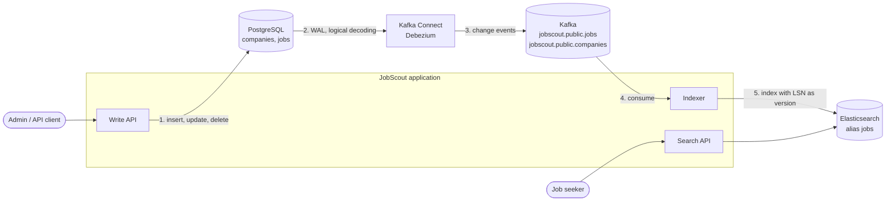

# JobScout

JobScout is the search side of a job board, written in Java with Spring Boot, PostgreSQL, Debezium, Kafka and Elasticsearch. Job postings are written to PostgreSQL only. Debezium reads every committed change from PostgreSQL's write-ahead log and publishes it to Kafka, and an indexer in the application keeps an Elasticsearch index in step. On top of that index sits a Turkish job search with typo tolerance, filters with live counts and suggestions while typing.

I built it to practise two things that come up in almost every product backend: making search good, and keeping a second copy of the data correct without ever writing to two places at once.

[](https://github.com/hmzckd/jobscout/actions/workflows/ci.yml)

## What it includes

- Write API for companies and jobs that touches PostgreSQL only and knows nothing about Elasticsearch
- Change data capture with Debezium's PostgreSQL connector in Kafka Connect, registered by the application at startup
- An indexer that applies change events to Elasticsearch in order, using the WAL position (LSN) as the document version, so replayed or late events never overwrite newer data
- Turkish text analysis: Turkish lowercasing (`I` → `ı`), stemming (`mühendisleri` finds `mühendis`) and folding (`gelistirici` finds `geliştirici`)
- Relevance tuned with field weights, typo tolerance (`kubernets`, `ankra`), every word required, closed jobs hidden, highlighted matches
- Filters for city, work mode, seniority, skills and minimum salary, with facet counts that stay correct while filters are selected
- Title suggestions while typing (`java ba` → `Java Backend Geliştirici`)
- Company renames copied into every indexed job of that company
- Zero-downtime rebuilds of the index behind an alias, started by hand or automatically when the index definition changes
- Index lag measured from the commit in PostgreSQL to the indexed document, exposed as a Prometheus metric
- 10,000 generated Turkish job postings, a small demo page and one `docker compose` command for the whole system
- Tests against real PostgreSQL, Kafka, Kafka Connect with Debezium and Elasticsearch with Testcontainers

## How it fits together



A write commits in PostgreSQL and the API answers. Debezium reads the commit from the write-ahead log through a replication slot and publishes a change event keyed by the job id, so all changes of one job stay in order in one partition. The indexer turns the event into a search document, adds the company name and writes it with the event's LSN as an external version. Elasticsearch rejects anything older than what it already has. A change is searchable about half a second after the commit.

Elasticsearch never holds anything that cannot be rebuilt from PostgreSQL. Losing the index loses search for a few seconds, not data.

## Stack

| Area | Technology |
| --- | --- |
| Service | Java 21, Spring Boot 4.1 (Web MVC, Actuator), virtual threads |
| Database | PostgreSQL 17 with `wal_level=logical`, Spring JDBC (`JdbcClient`), Flyway migrations |
| Change data capture | Debezium 3.7 PostgreSQL connector in Kafka Connect 4.2 |
| Messaging | Kafka 4.2 in KRaft mode, Spring for Apache Kafka |
| Search | Elasticsearch 9.4 with the official Java client |
| Metrics | Micrometer, Prometheus format |
| Tests | JUnit 5, Testcontainers, Awaitility |
| Container | Multi-stage Dockerfile, JRE image, non-root user |
| CI | GitHub Actions |

## Repository layout

```text
.
├── src/main/java/com/hmzckd/jobscout/
│   ├── company/          companies: create, read, rename
│   ├── job/              jobs: create, read, update, close, delete
│   ├── cdc/              Debezium connector settings and registration
│   ├── indexer/          Kafka listeners, change handling, reindex, startup index check
│   ├── search/           index definition, search, facets, suggestions
│   ├── seed/             generated Turkish job postings
│   └── web/              errors as problem+json
├── src/main/resources/
│   ├── db/migration/     Flyway migrations
│   ├── elasticsearch/    index settings, analyzers and mapping
│   └── static/           demo page (HTML, CSS, JavaScript)
├── src/test/java/        integration tests with all services in containers
├── connect/              Kafka Connect image with the Debezium plugin
├── docs/adr/             architecture decision records
├── GLOSSARY.md           domain and search terms
├── Dockerfile
├── compose.yaml          PostgreSQL, Elasticsearch, Kafka, Kafka Connect and the application
└── .github/workflows/ci.yml
```

## Run locally

### Requirements

- Docker Desktop with about 4 GB of memory for containers
- JDK 21 or newer, to run the tests or the service without Docker

### 1. Start everything

```powershell
docker compose --profile app up -d --build
```

The first start builds the Kafka Connect image (it downloads the Debezium plugin from Maven Central and checks its SHA-256) and the application image. When the application is up it creates the search index, registers the Debezium connector and inserts 10,000 generated jobs. They are searchable within about half a minute.

| Service | Address |
| --- | --- |
| Application and demo page | `http://localhost:8080` |
| PostgreSQL | `localhost:5438`, database, user and password `jobscout` |
| Elasticsearch | `http://localhost:9200` |
| Kafka | `localhost:9095` |
| Kafka Connect | `http://localhost:8083` |

### 2. Search

Open `http://localhost:8080` and try:

- `gelistirici ankra`: no Turkish letters and a typo, still Ankara developer jobs
- `mühendisleri`: finds `Mühendisi` titles through stemming
- tick **Uzaktan** and **Docker** on the left and watch the other counts change
- type `java ba` slowly to see suggestions

### 3. Watch a change travel from PostgreSQL to search

```powershell
$company = Invoke-RestMethod -Method Post -Uri http://localhost:8080/api/companies -ContentType "application/json" -Body '{"name":"Kuzey Yazılım"}'
$job = @{ companyId = $company.id; title = "Zig Geliştirici"; description = "Sistem programlama ekibimize katıl."; city = "Eskişehir"; workMode = "REMOTE"; seniority = "MID"; skills = @("Zig", "Linux") } | ConvertTo-Json
Invoke-RestMethod -Method Post -Uri http://localhost:8080/api/jobs -ContentType "application/json; charset=utf-8" -Body ([Text.Encoding]::UTF8.GetBytes($job))
Invoke-RestMethod "http://localhost:8080/api/search?q=zig"
```

Now stop the application, change the job directly in PostgreSQL and start the application again:

```powershell
docker compose stop app
docker compose exec postgres psql -U jobscout -c "UPDATE jobs SET status = 'CLOSED' WHERE title LIKE 'Zig%'"
docker compose start app
Invoke-RestMethod "http://localhost:8080/api/search?q=zig"
```

Debezium recorded the update while the application was down. The indexer continues from its last offset in Kafka, and the closed job disappears from search soon after the start.

### 4. Rebuild the index while searching

```powershell
Invoke-RestMethod -Method Post -Uri http://localhost:8080/api/admin/reindex
```

The answer names the new index, the one it replaced, the number of jobs and the time it took (about 5 seconds for 10,000 jobs). Searches keep working during the rebuild.

### Run the application with Maven instead

```powershell
docker compose up -d
.\mvnw.cmd spring-boot:run "-Dspring-boot.run.arguments=--jobscout.seed.jobs=10000"
```

Without `--profile app`, compose starts only PostgreSQL, Elasticsearch, Kafka and Kafka Connect. The defaults in `application.properties` point at them.

| Variable | Default | Meaning |
| --- | --- | --- |
| `PORT` | `8080` | HTTP port |
| `SPRING_DATASOURCE_URL` | `jdbc:postgresql://localhost:5438/jobscout` | PostgreSQL |
| `SPRING_ELASTICSEARCH_URIS` | `http://localhost:9200` | Elasticsearch |
| `SPRING_KAFKA_BOOTSTRAP_SERVERS` | `localhost:9095` | Kafka |
| `JOBSCOUT_CDC_CONNECT_URL` | `http://localhost:8083` | Kafka Connect REST API |
| `JOBSCOUT_CDC_DATABASE_HOST` | `postgres` | PostgreSQL host as Kafka Connect sees it |
| `JOBSCOUT_SEED_JOBS` | not set | Number of jobs to generate when the jobs table is empty |

## Checks

Docker must be running, because the tests start their own PostgreSQL, Elasticsearch, Kafka and Kafka Connect containers:

```powershell
.\mvnw.cmd test
```

## API

| Method | Route | Purpose |
| --- | --- | --- |
| POST | `/api/companies` | Create a company |
| GET | `/api/companies/{id}` | Get a company |
| PUT | `/api/companies/{id}` | Rename a company; its indexed jobs follow |
| POST | `/api/jobs` | Create a job |
| GET | `/api/jobs/{id}` | Get a job from PostgreSQL |
| PUT | `/api/jobs/{id}` | Replace a job |
| POST | `/api/jobs/{id}/close` | Close a job; it disappears from search |
| DELETE | `/api/jobs/{id}` | Delete a job |
| GET | `/api/search` | Search: `q`, `city`, `workMode`, `seniority`, `skill` (repeatable), `minSalary`, `sort` (`relevance` or `newest`), `page`, `size` |
| GET | `/api/suggest?q=` | Up to 10 job titles for the text typed so far |
| POST | `/api/admin/reindex` | Rebuild the index from PostgreSQL behind the alias |
| GET | `/actuator/health` | Health, including PostgreSQL, Elasticsearch and Kafka |
| GET | `/actuator/prometheus` | Metrics, including `jobscout_index_lag_seconds` and `jobscout_index_changes_total` |

A search answer contains `total`, the `hits` with highlighted `title` and `description` fragments, and `facets` with the counts for city, work mode, seniority and skill. Errors are returned as `application/problem+json`: 400 for invalid input, 404 for an unknown company or job, 409 when a reindex is already running. There is no authentication; the admin routes would sit behind one in a real deployment.

## Design decisions

| ADR | Decision |
| --- | --- |
| [0001](docs/adr/0001-use-the-official-elasticsearch-client.md) | The official Elasticsearch Java client, not Spring Data, so every query is visible |
| [0002](docs/adr/0002-keep-the-search-index-in-sync-with-debezium-cdc.md) | Debezium change data capture through Kafka instead of dual writes or an outbox |
| [0003](docs/adr/0003-use-the-wal-position-as-the-document-version.md) | The WAL position (LSN) as the external document version |
| [0004](docs/adr/0004-copy-the-company-name-into-each-job-document.md) | The company name copied into every job document |
| [0005](docs/adr/0005-rebuild-the-index-behind-an-alias.md) | Rebuilds behind an alias with double writes, without stopping search |

## Possible next steps

- Index in batches with the bulk API from the Kafka listener as well, to raise throughput beyond a few hundred changes a second
- Suggest skills and companies, not only job titles
- A dead-letter topic for events that can never be indexed, instead of logging and skipping them
